<div align="center">

# JSON Surgery · JSON 手术室

**一个真正跑在浏览器本地的 JSON 工作台：格式化、校验、树形浏览、JSONPath 查询、双栏 Diff、结构统计。**
**你的 JSON 不会离开这台设备 —— 没有后端，没有上传，没有埋点。**

[](https://iiiiiiiiiiiiiKK.github.io/json-surgery/)
[](https://github.com/iiiiiiiiiiiiiKK/json-surgery/actions/workflows/ci.yml)
[](LICENSE)
[](https://x.com/0xkillcoin)

[在线使用](https://iiiiiiiiiiiiiKK.github.io/json-surgery/) · [功能](#功能) · [快捷键](#快捷键) · [本地开发](#本地开发) · [隐私说明](#隐私与安全) · [已知限制](#已知限制)

作者：**𝕏 [@0xkillcoin](https://x.com/0xkillcoin)**

</div>

---

<div align="center">

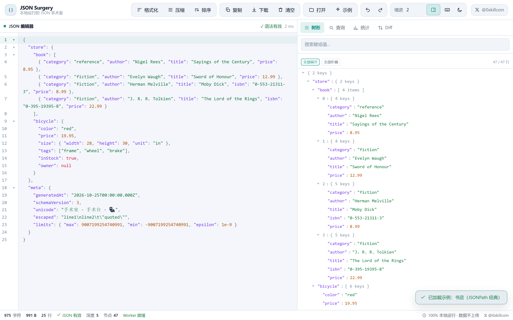

<sub>桌面端：左侧 CodeMirror 编辑器 · 右侧可切换的树形 / 查询 / 统计 / Diff 面板 · 底部状态栏（字符数、字节数、深度、节点数、解析状态）</sub>

</div>

---

## 它解决什么问题

在浏览器里打开一个「JSON 在线工具」，通常意味着把你刚拿到的东西——生产环境的配置、客户的接口响应、带 token 的日志、还没提交的 schema——**粘贴到别人的服务器上**。而且这些工具往往：

- 报错只说 `Unexpected token } in JSON at position 4213`，你还得自己数到第 4213 个字符；
- 格式化完发现 `1.50` 变成了 `1.5`、键的顺序被打乱，你没法判断「差异」是真改动还是工具改的；
- 打开 10 MB 的接口响应，标签页直接卡死；
- 想对比两份 JSON，只能靠肉眼或命令行。

JSON Surgery 把这些麻烦收敛到一个页面里，并且**全部在本地完成**：

| 痛点 | 这里的做法 |
| --- | --- |
| 粘贴到别人服务器 | 纯静态前端，构建产物里没有任何后端调用；`fetch`/`XHR` 只用来加载自己的 JS |
| 错误信息没用 | 自研严格解析器，报**行 + 列 + 具体原因**（多余逗号、缺括号、未转义控制字符、重复键、Unicode 转义错误……），并支持一键跳转到出错位置 |
| 格式化悄悄改语义 | 解析成保留**原始键顺序**与**原始数字字面量**的 AST，`1.50`/`1e3`/`-0` 原样保留；排序是显式操作且只动对象键，数组顺序永不变 |
| 大文件卡死 | 解析/格式化/Diff/查询跑在 Web Worker；树的渲染有节点上限 + 分页；状态栏实时显示大小与处理状态 |
| 不会写 JSONPath | 内置表达式示例与**支持范围语法表**，命中结果带完整路径，还能一键定位回树形视图 |
| 没法比对 | 双栏 Diff，按结构比对（不是按行），标出新增/删除/修改/类型变化，并给出 JSONPath |

## 功能

### 1. 输入

- 直接粘贴 / 输入，实时（防抖 240ms）校验；
- **拖放** `.json` 文件到窗口任意位置；
- **打开本地文件**（`Ctrl+Shift+O`），读取后文件名显示在编辑区标题；
- 超过 **32 MB** 的文件在读入前就被拒绝并提示上限，避免把内存打满；
- 超过 **2 MB** 的文档暂停自动解析，改为显式「重新解析」，保证输入不卡。

### 2. 一键操作

| 按钮 | 行为 |
| --- | --- |
| 格式化 | 按所选缩进（2/4/1/Tab）重排，保留键顺序与数字字面量 |
| 压缩 | 输出单行紧凑 JSON |
| 排序 | **按需**递归排序对象键（自然序：`item2` 排在 `item10` 前），数组顺序不变 |
| 复制 | 复制全文到剪贴板，成功/失败都有 toast 反馈（含 `execCommand` 兜底） |
| 下载 | 下载 `.json` 文件，文件名带时间戳 |
| 清空 | 清空编辑器与所有面板状态 |
| 撤销 / 重做 | 每次格式化/示例/清空都是独立的历史步骤，`Ctrl+Z` 逐步回退 |
| 示例 | 打开**示例库**（19 个示例 / 5 个分类 / 可搜索，见下文） |

#### 示例库（19 个内置示例）

点「示例」不再是「载入某一个固定文件」，而是打开一个可按分类浏览、可搜索的示例库。示例挑的是**结构形态的广度**，不是数据量：

| 分类 | 示例 | 形态与用途 |
| --- | --- | --- |
| 入门 | 书店 | 对象 + 数组 + 嵌套，配合 `$.store.book[*].title` 说明 JSONPath |
| API | REST API 响应 | 分页、速率限制、多语言用户、`null` 字段 |
| API | JSON-RPC 区块数据 | 交易数组 + 日志事件，两层数组嵌套 |
| 配置 | JSON Schema | draft 2020-12，含 `enum` / `pattern` / `additionalProperties` |
| 配置 | package.json | 脚本、依赖、workspaces、`publishConfig` |
| 配置 | 多语言文案 | 嵌套键、复数形式、`{placeholder}` 占位符 |
| 数据 | GeoJSON 地标 | `Point` / `Polygon` 坐标 + `bbox`，浮点数组 |
| 数据 | 时序指标 | 12 个时间点 + 汇总，监控面板常见结构 |
| 数据 | 结构化日志 | **顶层就是数组**，7 条日志含嵌套 `error` 对象 |
| 数据 | 电商订单 | 正常 / 已退款两笔，含地址、税额、`refund` 对象 |
| 数据 | 行矩阵 | 数组的数组（表格导出形态），Diff 按位置比较 |
| 数据 | 文件树 | 递归 `children`，最深的三层树形演示 |
| 边界 | 边界用例 | 代理对 emoji、全部转义、`-0` / `5e-324` / ±2^53、空容器、6 层嵌套 |
| 边界 | 批量订单（120 条） | 约 40 KB，验证大文档不卡；**生成器确定性**，两次生成字节相同 |
| 边界 | 错误：多余逗号 / 键未加引号 / 注释 / 两个文档 / 超深嵌套 | 5 个**故意非法**的示例，用来演示错误定位与「跳转」 |

- 每个示例都写清了「它适合演示什么」（如 `试试 $.store.book[*].title`），示例库本身就是用法说明；
- 非法的示例带红色「故意错误」标签，点开后会立刻看到错误横幅与行列位置 —— **不会**被误认为工具崩了；
- 分类与搜索都可用；手机上示例库自动变成贴底抽屉。

<div align="center">

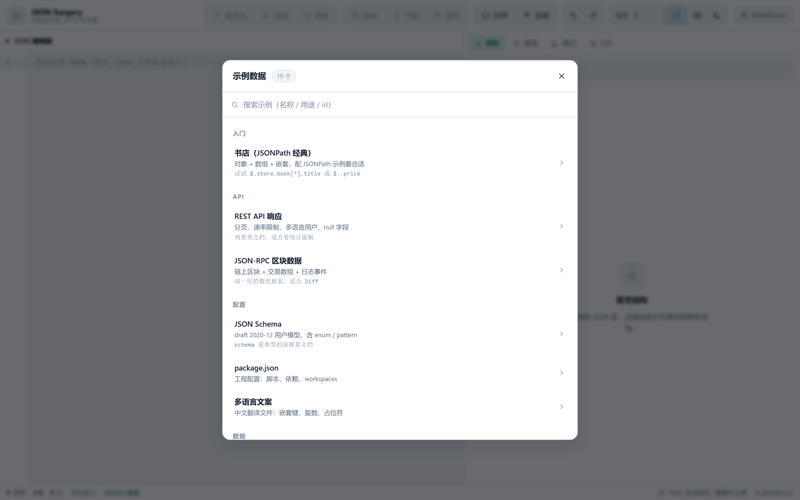

</div>

### 3. 语法校验

自研的严格解析器（无第三方解析依赖）覆盖 RFC 8259，并把错误翻译成人话：

```
第 3 行 · 第 12 列  数组中存在多余的逗号：最后一个元素之后不允许再出现 "，"（删除末尾逗号即可）。
```

可识别的错误码：`EMPTY_INPUT`、`UNEXPECTED_CHARACTER`、`UNEXPECTED_END`、`INVALID_STRING`、`INVALID_ESCAPE`、`INVALID_NUMBER`、`TRAILING_COMMA`、`TRAILING_CONTENT`、`DUPLICATE_KEY`、`DEPTH_EXCEEDED`、`SIZE_EXCEEDED`。

**非致命提示**（文档仍然有效，但值得知道）：

- 整数超出 ±2^53−1（`9007199254740993`）→ 提示精度可能已丢失。`UNSAFE_NUMBER` 警告不阻断格式化或查询。

<div align="center">

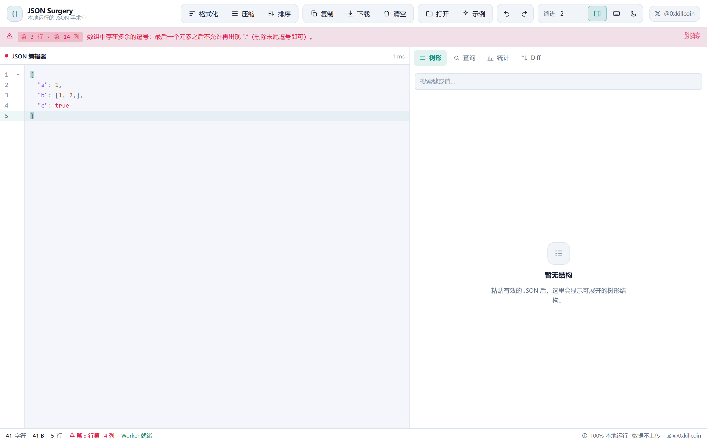

<sub>错误横幅给出「行 · 列 + 原因」，右侧有「跳转」按钮直接把光标移到出错处</sub>

</div>

### 4. 树形查看

- 节点展开 / 折叠，支持「全部展开」「全部折叠」；
- 键名与标量值的**搜索高亮**，自动展开命中路径；
- 每个节点可**复制路径**（`$.store.book[0].title`）或复制值；
- 键盘导航：`↑`/`↓` 移动选中行，`→` 展开，`←` 折叠；
- 超过 **20,000** 个节点时树会截断并明确标注「树已截断」（统计数字仍然完整），列表按 400 行分页加载，避免 DOM 爆炸；
- 行左侧显示类型配色：对象/数组灰色摘要、字符串绿色、数字橙色、布尔红色、`null` 灰蓝。

### 5. JSONPath 查询

引擎是 [`jsonpath-plus`](https://www.npmjs.com/package/jsonpath-plus)（MIT），运行在 Worker 里。**支持范围是明确的**，界面上可直接展开语法表：

| 语法 | 含义 |
| --- | --- |
| `$` | 根节点 |
| `.key` / `['key']` | 按名字取成员 |
| `[0]` / `[0,2]` / `[1:3]` | 数组下标、索引列表、切片 |
| `[*]` | 子元素通配符 |
| `..key` / `..*` | 递归下降 |
| `[?(@.price > 10)]` | 过滤表达式（比较、逻辑、正则 `=~`） |
| `['a','b']` | 联合 |
| `@` / `$` / `^` | 当前节点 / 根节点 / 父节点 |

每条命中都显示 **JSONPath + 格式化后的值**，可单条复制、全部复制，或点「定位」跳回树形视图并展开到该节点（内部会把 `$['a']['b'][0]` 与 `$.a.b[0]` 归一化后匹配）。

<div align="center">

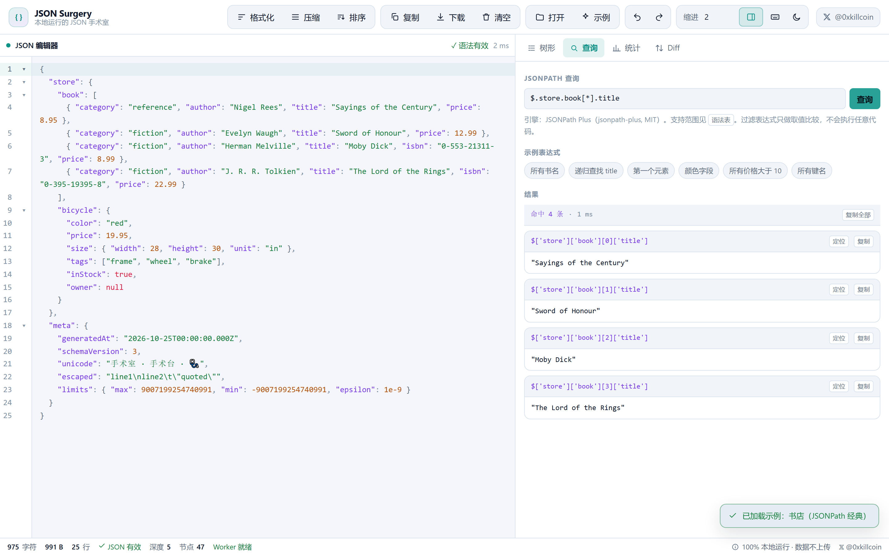

</div>

### 6. 双栏 JSON Diff

- 桌面端：左右两个编辑器 + 右侧结果面板；移动端切换标签；
- 按**结构**比对（对象按键、数组按下标），不是按行；
- 标记 `新增` / `删除` / `修改` / `类型变化`，给出路径与前后值摘要；
- 两侧 JSON 非法时分别指出是哪一侧、第几行第几列出错；
- 完全一致时显示「两个文档完全一致」。

<div align="center">

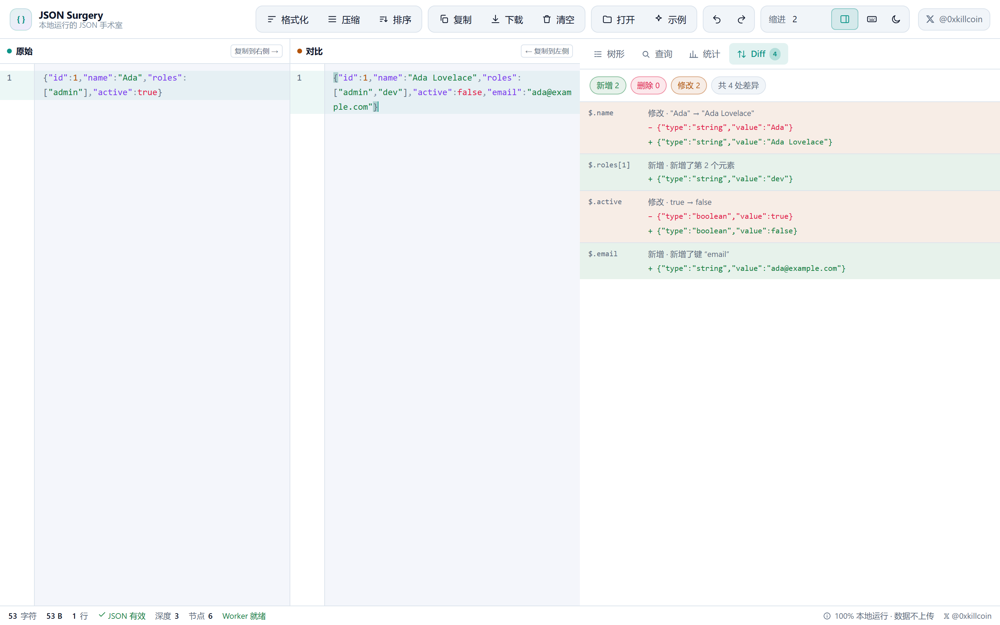

</div>

### 7. 结构统计

对象、数组、键、字符串、数字、布尔值、`null` 的数量，加上**最大嵌套深度**、节点总数、叶子数、容器数、字符数与 UTF-8 字节数。所有统计用显式栈迭代计算，不依赖递归，深文档不会爆栈。

<div align="center">

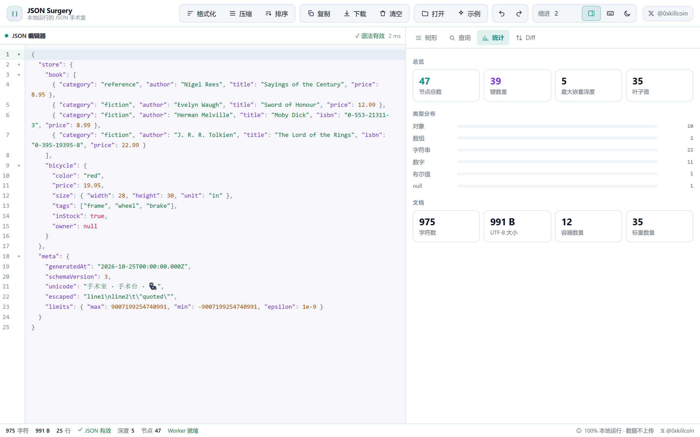

</div>

### 8. 界面

- 编辑器工作台布局：顶部操作栏 / 中间编辑区 / 可折叠结果面板 / 底部状态栏；
- **深色 + 浅色**主题（首屏前就恢复主题，不闪白），跟随系统偏好；
- 移动端（≤860px）切换为「编辑器 / 结果面板」双标签视图 + 固定两行的紧凑头部；
- 合理的空状态、加载态（Worker 就绪 / 主线程模式）、复制 toast、拖放遮罩、快捷键面板、示例库；
- 顶部作者 **𝕏 [@0xkillcoin](https://x.com/0xkillcoin)** 徽标（状态栏也有一个）。

#### 视觉语言：同一套「克制的强调色」

第一版的 logo 是一块高饱和的青→紫渐变方块（`#2dd4bf → #a78bfa`），放在中性的顶栏里像贴上去的另一个东西；右上角的 𝕏 还是个圆胶囊，紧挨着的 ⋯ 却是方角按钮 —— 同一条水平线上出现两种形状，看着就别扭。现在统一为：

- **logo**：淡染块，不再是纯色块。底色是「强调色 15% + 表面色」的混色，配 1px 同色系描边与 10px 圆角，`{ }` 用强调色本身。实测与顶栏底色的亮度差仅 **0.073（深色）/ 0.138（浅色）**，属于「同色域」，不再突兀；
- **𝕏 徽标与 ⋯ 触发器**：同一套几何 —— 都是 **32×32、10px 圆角、1px 边框、相同背景**，手机端两者尺寸像素级一致（`32×32 / r=10px`）；桌面端 𝕏 带 `@0xkillcoin` 文字拉宽到 104×32，但圆角、高度、边框与前后的工具栏按钮依然一致；
- 强调色只保留在「图标本身」与「选中态」上，不再有大面积饱和填充。

这两条契约被 `scripts/audit-visual.mjs` 用**计算样式**（而非看图）逐视口断言，改坏会立刻失败。

#### 手机端顶部：两行定高，而不是「按钮堆」

早期的移动端顶部是把桌面工具栏原样换行，实测在 320px 上会堆到 **3 行 / 180px 高**（占 844px 屏高的 21%），而且 428px 因为分组边界还会突兀地变回 3 行 —— 这就是「感觉不够顺」的根源。现在改成固定结构：

```
┌────────────────────────────────────────────┐
│ { } JSON Surgery            [𝕏]  [⋯]      │  ← 第 1 行：品牌 · 作者 · 更多
├──────┬──────┬──────┬──────┬──────┬────────┤
│ 格式化│ 压缩 │ 复制 │ 下载 │ 示例 │  打开  │  ← 第 2 行：6 个高频操作
└──────┴──────┴──────┴──────┴──────┴────────┘
```

- **定高 99px**（320 → 834px 全部一致，不再随宽度在 2 行 / 3 行之间跳动）；
- 第 2 行是 6 列等分网格，**永不换行**，每个按钮 46px 高、带图标 + 中文标签（不是只有图标）；
- 剩下的操作（排序、撤销/重做、清空、缩进、面板、主题、快捷键）收进 **⋯ 底部抽屉**，48px 行高、拇指可达、点击后自动关闭；
- 抽屉支持遮罩点击 / `Esc` 关闭、焦点陷阱与焦点归还（关闭后回到 ⋯ 按钮），并在 `aria-expanded` 上反映状态。

<div align="center">

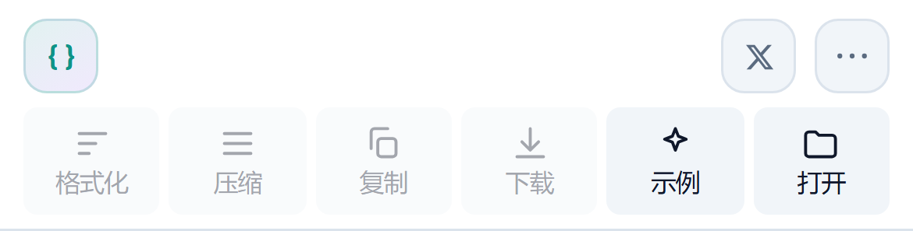

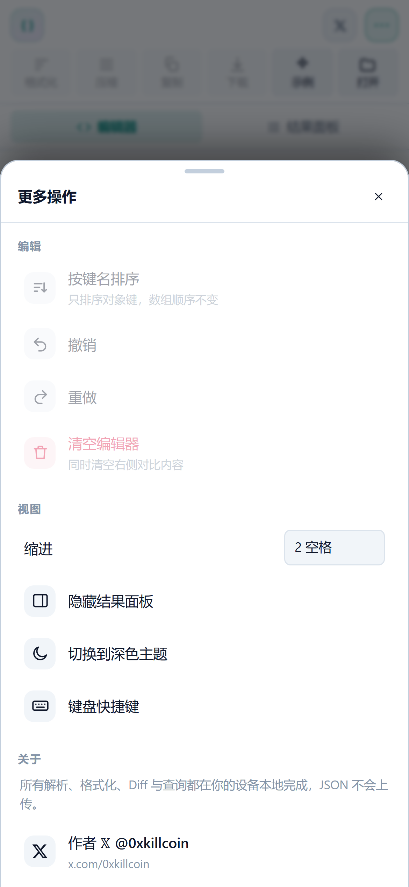

</div>

对比（实测像素）：

| | 改前 | 改后 |
| --- | --- | --- |
| 320px 顶部高度 | 180px（3 行） | **99px（2 行）** |
| 390px 顶部高度 | 135px（2 行） | **99px（2 行）** |
| 428px 顶部高度 | 180px（3 行，抖动） | **99px（2 行）** |
| 屏幕留给编辑区 | 565px（320px 机型） | **646px（390px 机型）** |
| 依赖「只有图标」猜按钮 | 是（≤420px 隐藏文案） | 否（恒有中文标签） |

#### 顶部作者 𝕏 徽标

徽标是 `<header>` 的直接子元素（不放在会换行的工具栏里），因此**在任何宽度下都停在第一行的右侧**：

| 桌面（≥861px） | 手机（≤860px） |
| --- | --- |
| 一行：[品牌] ——— [工具栏] [𝕏 @0xkillcoin] | 第一行：[品牌] ——— [𝕏] [⋯]；第二行：6 个常用操作 |

- `href="https://x.com/0xkillcoin"`，`target="_blank"`，`rel="noopener noreferrer"`；
- 桌面显示 `𝕏 @0xkillcoin`（103×33px），手机显示图标（32×28px），均 ≥ WCAG 2.5.8 的最小点击区域；
- 键盘可达（`Tab` 聚焦 + `:focus-visible` 描边），带 `aria-label="作者 𝕏：@0xkillcoin"`；抽屉底部还有一个带 `@0xkillcoin` 文字的入口。

<div align="center">

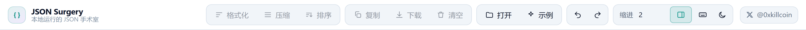

</div>

#### 响应式矩阵（实测）

12 个视口全部实测通过（`scripts/audit-responsive.mjs`，读取真实 DOM 几何值）：

| 视口 | 宽度 | 布局 | 顶部高度 | 横向溢出 | 𝕏 徽标 |
| --- | --- | --- | --- | --- | --- |
| iPhone SE (1st) | 320px | 单栏 + 标签 | 99px | 无 | 32×28，y=10px |
| iPhone SE (2/3) | 375px | 单栏 + 标签 | 99px | 无 | 32×28，y=10px |
| iPhone 13 mini | 375px | 单栏 + 标签 | 99px | 无 | 32×28，y=10px |
| iPhone 13 | 390px | 单栏 + 标签 | 99px | 无 | 32×28，y=10px |
| iPhone 13 Pro Max | 428px | 单栏 + 标签 | 99px | 无 | 32×28，y=10px |
| iPhone 15 Pro | 393px | 单栏 + 标签 | 99px | 无 | 32×28，y=10px |
| iPad mini 竖屏 | 744px | 单栏 + 标签 | 99px | 无 | 32×28，y=10px |
| iPad Pro 11 竖屏 | 834px | 单栏 + 标签 | 99px | 无 | 32×28，y=10px |
| 小笔记本 | 1024px | 左右并排 | 91px | 无 | 103×33，y=6px |
| 笔记本 | 1280px | 左右并排 | 56px | 无 | 103×33，y=11px |
| 桌面 | 1440px | 左右并排 | 56px | 无 | 103×33，y=11px |
| 桌面 | 1920px | 左右并排 | 56px | 无 | 103×33，y=11px |

断点：`1024px`（隐藏品牌副标题）· `1180→861px`（桌面工具栏换行，避免横向滚动条）· `860px`（单栏 + 双标签 + 紧凑头部）· `420px`（隐藏品牌文字，只留 logo）。

<div align="center">

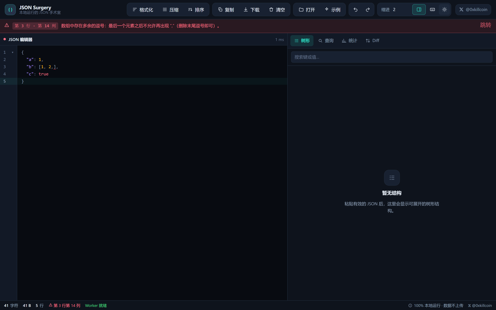

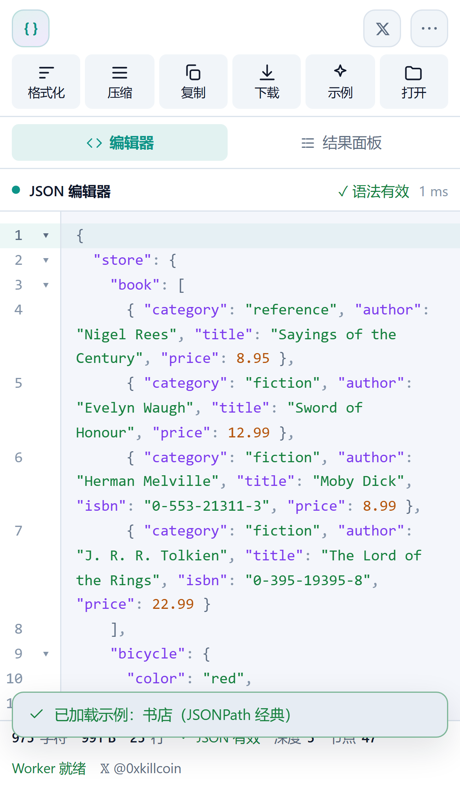
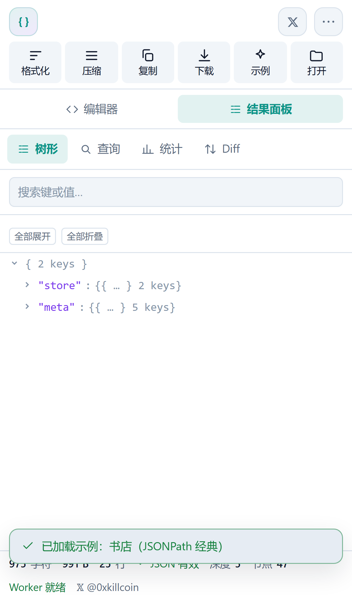
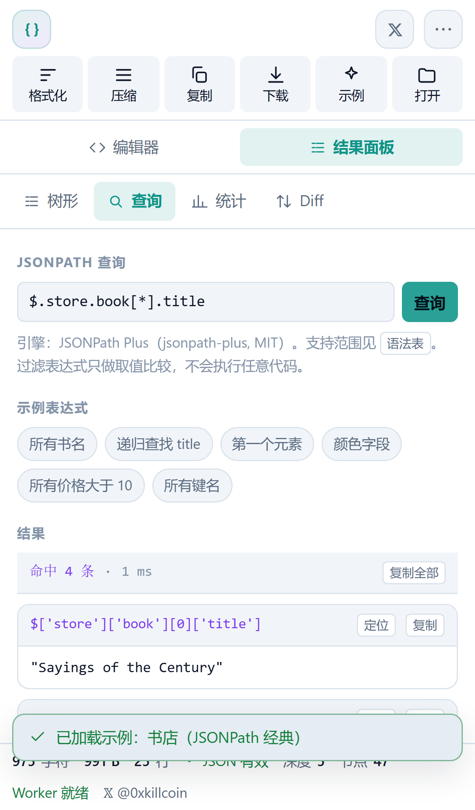

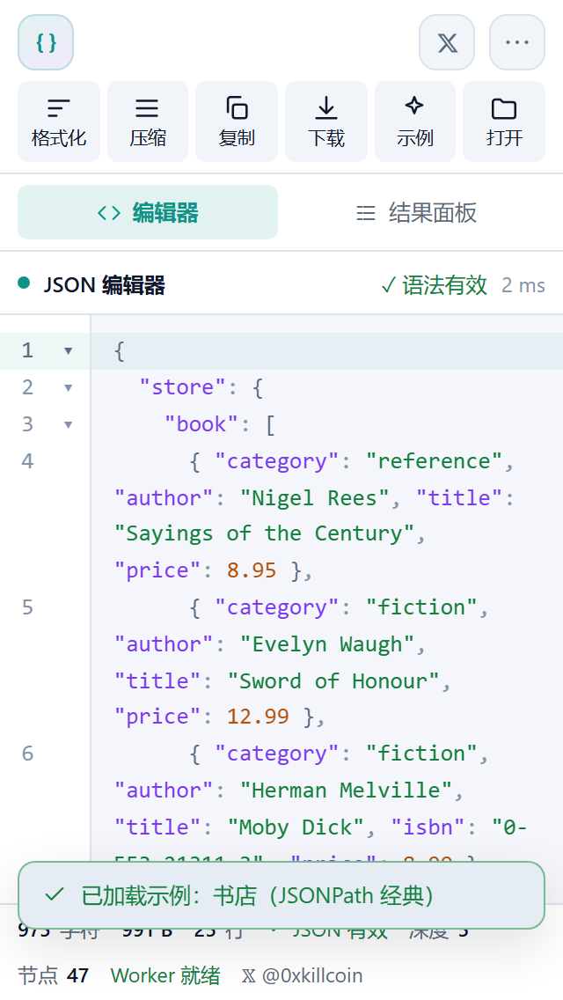
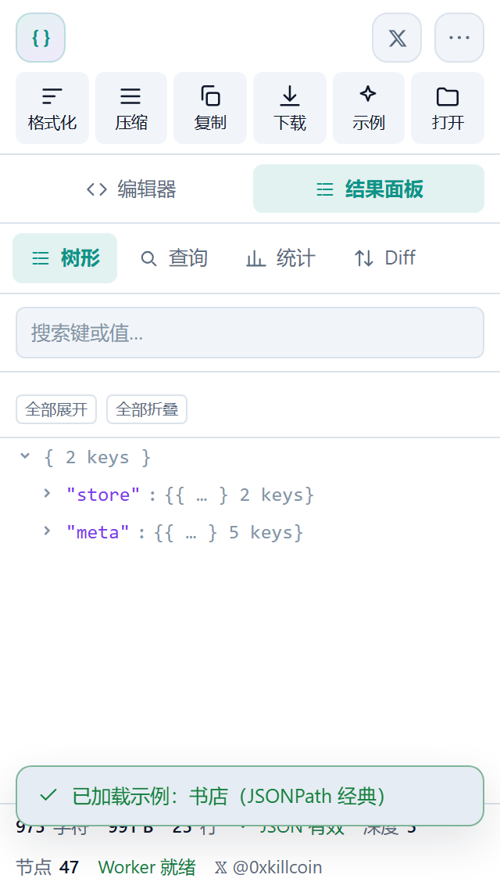

</div>

## 快捷键

`Ctrl` 在 macOS 上对应 `⌘`。

| 快捷键 | 动作 |
| --- | --- |
| `Ctrl + Shift + F` | 格式化 |
| `Ctrl + Shift + M` | 压缩 |
| `Ctrl + Shift + S` | 按键名排序 |
| `Ctrl + Shift + C` | 复制全文 |
| `Ctrl + Shift + D` | 下载 `.json` |
| `Ctrl + Shift + K` | 清空 |
| `Ctrl + Shift + O` | 打开本地文件 |
| `Ctrl + Shift + T` | 切换深色 / 浅色 |
| `Ctrl + Shift + U` | 加载示例 |
| `Ctrl + Shift + Z` | 重做 |
| `Ctrl + Z` | 撤销 |
| `Ctrl + Enter` | 重新解析 |
| `Ctrl + B` | 显示 / 隐藏结果面板 |
| `Ctrl + 1..4` | 切换到 树形 / 查询 / 统计 / Diff |
| `Ctrl + F` | 编辑器内搜索（CodeMirror） |
| `Esc` | 关闭对话框 |
| `Ctrl + S` | 编辑器内：格式化（阻止浏览器保存） |

<div align="center">

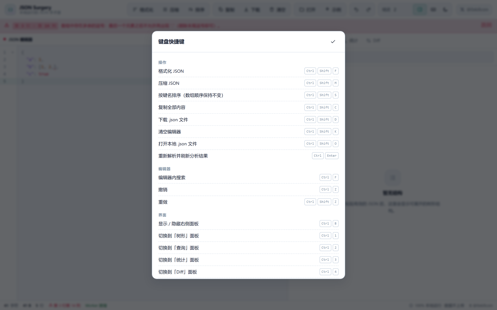

</div>

## 技术栈

| 层 | 选择 | 说明 |
| --- | --- | --- |
| 框架 | **React 18** + **TypeScript 5**（strict） | 函数组件 + hooks，无状态管理库 |
| 构建 | **Vite 6** | `base: './'`，因此同一份产物可部署在域名根、GitHub Pages 子路径或任意静态目录 |
| 编辑器 | **CodeMirror 6**（`@codemirror/*`, MIT） | JSON 语法高亮、折叠、括号匹配、搜索面板、lint 下的划线标记、多光标 |
| 查询 | **jsonpath-plus**（MIT） | 在 Worker 中执行，限制命中数 500 |
| 解析 | **自研**（本项目 `src/lib/parser.ts`） | 保留键顺序与数字字面量，给出行列与原因；无第三方解析依赖 |
| 并发 | **Web Worker**（`src/workers/json.worker.ts`） | 解析 / 格式化 / 统计 / Diff / 查询都在 Worker；不可用或超时（30s）时自动回落到主线程同一套函数 |
| 测试 | **Vitest** + **Playwright** | 116 个单元测试；72 个端到端用例（桌面功能 26 + iPhone 触控 11 + 响应式矩阵 30 + 示例库 5） |
| 样式 | 原生 CSS + CSS 变量 | 无 UI 框架，主题靠 `html[data-theme]` 切换 |

### 架构

```
src/
├─ lib/            # 纯函数引擎，可在 Worker 与主线程复用（无 DOM、无网络、无存储）
│  ├─ ast.ts       # AST 类型、深拷贝、结构相等、预览
│  ├─ parser.ts    # 严格 JSON 解析器（行列 + 原因 + 非致命警告）
│  ├─ format.ts    # 美化 / 压缩 / 键排序 / 字节格式化
│  ├─ tree.ts      # 扁平行模型（深度、路径、父子、节点上限）
│  ├─ stats.ts     # 迭代式统计（无递归）
│  ├─ diff.ts      # 结构 Diff
│  ├─ query.ts     # JSONPath 封装（jsonpath-plus）
│  ├─ paths.ts     # 路径归一化（$['a'][0] ⇄ $.a[0]）
│  └─ protocol.ts  # UI ⇄ Worker 消息协议
├─ workers/json.worker.ts
├─ hooks/          # useJsonWorker / useTheme / useToasts
├─ components/     # JsonEditor / TreeView / QueryPanel / DiffPanel / StatsPanel / ShortcutsDialog / Icon
└─ App.tsx         # 工作台装配：状态、快捷键、拖放、文件、布局
```

设计约束：**`src/lib` 里没有任何 `fetch`、`XMLHttpRequest`、`localStorage`、`eval`、`new Function`**，只有纯数据变换，所以它能在 Worker、主线程、Node 测试环境里跑出完全一致的结果。

## 本地开发

需要 Node.js **20+**（CI 用 22）。

```bash
git clone https://github.com/iiiiiiiiiiiiiKK/json-surgery.git
cd json-surgery
npm ci

npm run dev        # 开发服务器 http://localhost:5173
npm run build      # 生产构建（tsc -b + vite build）→ dist/
npm run preview    # 预览生产构建 http://localhost:4173
```

### 测试

```bash
npm run test              # 单元测试（Vitest）
npm run test:coverage     # 覆盖率
npx playwright install chromium
npm run e2e               # 端到端（会自动 build+preview，监听 4193）
npm run check             # lint + 单元测试 + 生产构建
```

响应式回归（12 个真实视口，可对本地或线上跑）：

```bash
npm run build && npm run preview -- --port 4193 --strictPort &
npm run audit:responsive                      # 默认审计线上 Pages 地址
node scripts/audit-responsive.mjs http://127.0.0.1:4193/   # 或审计本地构建
# 结果写成 docs/responsive-audit.json，任一失败会以 exit code 1 退出
```

视觉契约回归（logo 淡染程度、𝕏 与 ⋯ 的形状一致性、示例库广度）：

```bash
node scripts/audit-visual.mjs http://127.0.0.1:4193/
# 2 个主题 × 2 个视口 = 22 项断言，全部读取计算样式，不依赖看图
```

顶部高度实测（改一行 CSS 就能看出有没有退化）：

```bash
npm run measure:header http://127.0.0.1:4193/
# 逐宽度打印 header / tabs / status 像素高度、工具栏行数
```

### 截图（需要本地 preview 在 4193 端口运行）

```bash
npm run build
npm run preview -- --port 4193 --strictPort &
npm run screenshots       # 输出到 docs/assets/
```

## 部署

### GitHub Pages（本仓库的实际部署方式）

仓库已包含 `.github/workflows/ci.yml`：

1. `push` 到 `main` → 跑 **Lint → Typecheck → Unit tests → Build → E2E（桌面 + iPhone）**；
2. `verify` 通过后，`deploy` 任务把 `dist/` 作为 Pages 产物发布；
3. 仓库设置 → Pages → Source 选择 **GitHub Actions** 即可（一次性配置）。

线上地址：**https://iiiiiiiiiiiiiKK.github.io/json-surgery/**

> `vite.config.ts` 里 `base: './'` 用的是相对路径，所以不需要为 Pages 的子路径做额外配置；同一份 `dist/` 也可以直接丢到 Cloudflare Pages、Vercel、Netlify 或任意对象存储。

### 其他静态托管

```bash
npm run build
# 把 dist/ 目录整体上传即可，构建产物不含任何服务端依赖
```

## 隐私与安全

- **默认完全本地运行。** 应用没有后端，没有 API 密钥，没有任何分析/错误上报 SDK；
- **不上传 JSON。** 数据只在内存里流转（编辑器 ↔ Worker），关闭页面即消失；
- **不持久化输入。** 唯一写入 `localStorage` 的是主题偏好（`json-surgery:theme`，值为 `dark` / `light`）；
- **不通过 eval 执行 JSON 内容。** 解析器手写状态机；JSONPath 过滤表达式由 `jsonpath-plus` 的安全求值器处理，本项目不开启其脚本求值模式；
- **资源边界。** 输入 >16 Mi 字符直接拒绝（`SIZE_EXCEEDED`）；嵌套 >256 层拒绝（`DEPTH_EXCEEDED`）；树 >20,000 节点截断并提示；文件 >32 MB 在读入前拒绝；Worker 任务超时 30 秒后回落主线程；
- **不使用第三方字体 CDN。** 字体走系统栈，避免任何跨域请求（E2E 里有一条用例断言「除同源静态资源外没有外部网络请求」）。

## 测试与验收

```
单元测试（Vitest）： 10 个文件 / 116 个用例  ✅
端到端（Playwright）：72 个用例              ✅
  ├─ desktop-chromium @1440×900   26 用例（功能）
  ├─ iphone-13 (390×844, DPR3)    11 用例（触控 / 顶部高度 / 底部抽屉）
  ├─ responsive-matrix            30 用例（320→1920 共 10 档视口 × 3 项断言）
  └─ samples                       5 用例（示例库：分组/搜索/逐个加载/错误示例）
响应式实测脚本（audit-responsive.mjs，12 视口） 104/104 ✅
视觉契约脚本（audit-visual.mjs，2 主题 × 2 视口）  22/22 ✅
生产构建：tsc -b && vite build                ✅
ESLint（--max-warnings 0）                    ✅
npm audit --omit=dev              0 vulnerabilities ✅
```

覆盖范围（节选）：

- **解析**：标准文档、Unicode/emoji、全部转义、`1.50`/`1e3`/`-0` 字面量保真、顶层标量、空数组/空对象、`null`、非法逗号、缺失括号、未转义控制字符、重复键、超深嵌套、超长输入、错误行列；
- **格式化**：缩进 0/1/2/4、压缩、键排序（数组顺序不变）、幂等性；
- **统计**：每种类型的计数、最大深度、空文档、深文档（201 层）；
- **Diff**：新增/删除/修改/类型变化、嵌套对象、数组增删、完全一致；
- **查询**：通配符、递归、切片、过滤、联合、父节点、非法表达式、上限截断；
- **路径**：`$['a'][0]` 与 `$.a[0]` 的归一与匹配；
- **端到端（功能）**：示例加载、格式化/排序/压缩真的改了内容、复制到剪贴板（读取校验）、下载事件、文件导入、超大文件拒绝、树搜索与路径复制、展开/折叠行数变化、查询→定位、非法表达式报错、Diff 三类差异、主题持久化、快捷键、撤销重做、Ctrl+F 搜索面板、无外部请求、大文档（约 640k 字符）后界面仍可交互；
- **端到端（响应式，320/375/390/428/744/834/1024/1280/1440/1920）**：𝕏 徽标在第一行右侧且可点击（含 `href`/`target`/`rel`/几何位置/尺寸）、无横向溢出（逐元素 `getBoundingClientRect` 扫描）、移动端标签真实切换面板 / 桌面端左右并排自动切换；
- **端到端（手机端头部，iPhone 13）**：顶部高度 ≤120px、常用操作栏恰好 6 个按钮且只有 1 行、每格 ≥44×44px 带中文标签、⋯ 打开底部抽屉且抽屉内排序/主题/快捷键真实生效、遮罩与 `Esc` 关闭并归还焦点、抽屉内所有行 ≥44px 高、Diff 视图无横向溢出；
- **端到端（示例库）**：19 个示例按 5 类分组、搜索可缩窄并给出空态、**逐个加载全部有效示例并断言无一报错**、5 个故意错误示例确实给出错误行列、`Esc`/遮罩关闭且不覆盖已有内容、示例 → JSONPath 联动；
- **单元（示例库）**：id 唯一、有效示例全部可解析、错误示例确实解析失败且错误码符合预期、结构形态足够广（含顶层数组与 ≥5 层嵌套）、批量示例确定性（两次生成字节相同）且尺寸区间合理。

## 已知限制

- **重复键**按错误处理（RFC 8259 未定义行为，不同解析器结果不同）。如果你的数据确实含重复键，请先自行清理。
- **数字精度**：超过 ±2^53−1 的整数在 JS 中无法精确表示；解析器会保留原始字面量并给出警告，但查询/Diff 比较的是数值。
- **树形视图上限 20,000 节点**：统计与查询不受影响，只是交互式树被截断（界面上有明确标注）。
- **JSONPath 只读**：不支持写回/变换（如 `~` 修饰、脚本表达式）。命中数上限 500。
- **Diff 是结构化比对**，不是文本行级 diff；数组按位置比较，插入元素会表现为后续位置大量「修改」。
- **超大数据**（>16 Mi 字符）会被拒绝而不是流式处理——这是刻意的内存保护。
- `Ctrl+Shift+Z` 由应用接管为重做；在 macOS 上二者都映射到 `⌘`。

## 贡献

Issues / PR 都欢迎。请在提交前跑通：

```bash
npm run check && npm run e2e
```

## 许可

[MIT](LICENSE) © 2026 KK ([@0xkillcoin](https://x.com/0xkillcoin))

第三方依赖均为 MIT（React、CodeMirror、jsonpath-plus、Vite、Vitest、Playwright）。

---

<div align="center">

**如果这个工具帮你省了一次「把生产配置粘到别人网站」的冒险，欢迎点个 ⭐**

𝕏 [@0xkillcoin](https://x.com/0xkillcoin)

</div>
